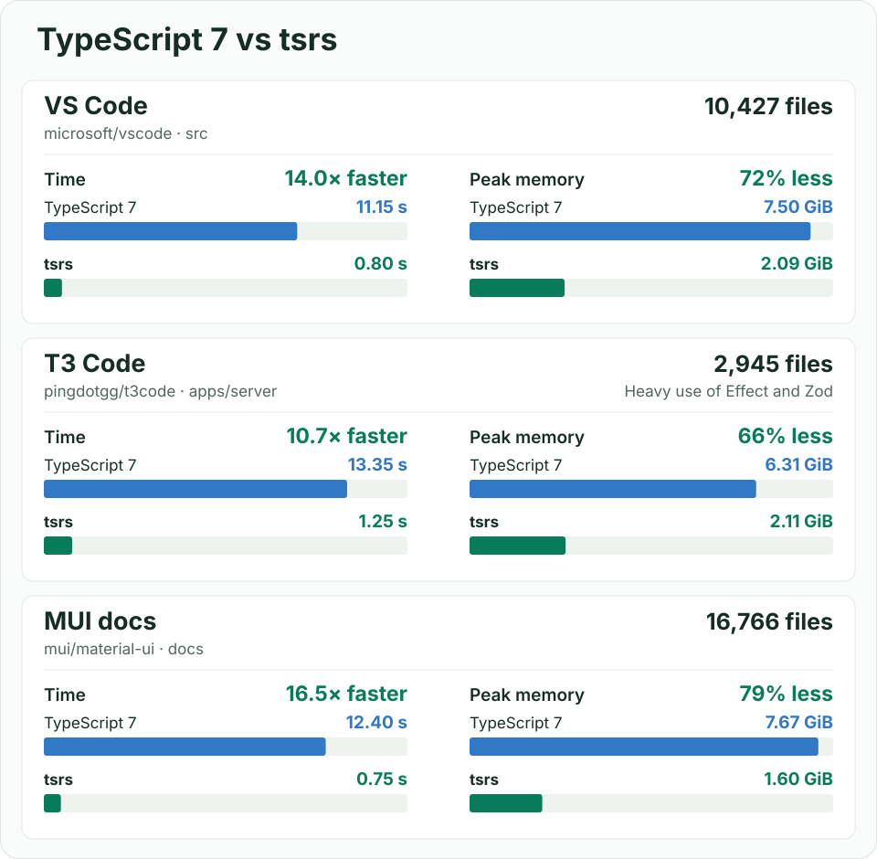

<!-- bench:start -->
<!-- Generated by bench/run.py from bench/results/; the bench workflow (.depot/workflows/bench.yml) rewrites this section. Edit the generator, not this text. -->
## Benchmark: tsrs vs tsgo 7.0.2 vs bun check

Time and peak memory to type-check each project (`-p <project> --noEmit`) on Depot CI `depot-ubuntu-24.04-16` (16 vCPU, 63 GB RAM, Linux x86_64, AMD EPYC 9R45 96-Core Processor). Median of 10 interleaved runs (3 for tsgo).

- **tsrs**: commit `33c418ed0a73`, PGO-optimized `dist` build, built like the npm release binaries.
- **tsgo**: npm `typescript@7.0.2`, the official Go compiler. tsrs ports a later 7.1-dev commit (`b85298b6`).
- **bun check**: Bun 1.4.4-canary.1+6c1eb067e.

Projects: vscode, xstate-main, webpack, mui-docs, Compiler, Compiler-Unions are from [microsoft/typescript-benchmarking](https://github.com/microsoft/typescript-benchmarking), the suite the TypeScript team benchmarks tsgo on; the other 11 are large open-source applications.

### Default settings on 16 vCPUs

No thread flags: tsgo runs 4 checker threads; tsrs runs 16 (its default: all cores up to 16, then half the cores, at most 32; fewer on small projects); bun check runs one thread per core.

**Wall time**

| project | tsgo | tsrs | bun check | tsrs vs tsgo | tsrs vs bun |
| --- | ---: | ---: | ---: | ---: | ---: |
| mui-docs | 11.93 s | 0.74 s | 7.28 s | **16.03x faster** | 9.79x faster |
| next-packages-next | 3.03 s | 0.21 s | 0.40 s | **14.70x faster** | 1.95x faster |
| mikro-orm | 10.76 s | 0.78 s | 2.00 s | **13.82x faster** | 2.57x faster |
| vscode | 11.37 s | 0.86 s | 1.65 s | **13.26x faster** | 1.92x faster |
| storybook | 1.65 s | 0.15 s | 0.29 s | **11.28x faster** | 1.97x faster |
| formbricks-web | 6.77 s | 0.61 s | 1.01 s | **11.14x faster** | 1.67x faster |
| supabase-studio | 6.56 s | 0.60 s | 1.59 s | **10.93x faster** | 2.65x faster |
| t3code-server | 13.38 s | 1.35 s | 2.70 s | **9.91x faster** | 2.00x faster |
| webpack | 1.32 s | 0.13 s | 0.30 s | **9.87x faster** | 2.25x faster |
| drizzle-orm | 1.82 s | 0.19 s | 0.42 s | **9.56x faster** | 2.21x faster |
| cal-diy | 5.46 s | 0.58 s | 1.47 s | **9.36x faster** | 2.52x faster |
| next-root | 1.58 s | 0.17 s | 0.30 s | **9.07x faster** | 1.72x faster |
| playwright | 1.11 s | 0.12 s | 0.23 s | **9.01x faster** | 1.85x faster |
| nuxt | 1.30 s | 0.17 s | 0.44 s | **7.76x faster** | 2.64x faster |
| xstate-main | 0.81 s | 0.11 s | 0.16 s | **7.11x faster** | 1.39x faster |
| Compiler-Unions | 0.52 s | 0.09 s | 0.20 s | **5.70x faster** | 2.23x faster |
| Compiler | 0.27 s | 0.06 s | 0.11 s | 4.30x faster | 1.74x faster |

**Peak memory**

| project | tsgo | tsrs | bun check | tsrs vs tsgo | tsrs vs bun |
| --- | ---: | ---: | ---: | ---: | ---: |
| mui-docs | 7.52 GiB | 1.60 GiB | 11.70 GiB | **4.70x less** | 7.32x less |
| next-packages-next | 1.73 GiB | 692 MiB | 737 MiB | 2.56x less | 1.06x less |
| mikro-orm | 6.54 GiB | 1.97 GiB | 1.40 GiB | 3.31x less | 1.41x more |
| vscode | 7.51 GiB | 2.09 GiB | 1.86 GiB | 3.60x less | 1.12x more |
| storybook | 1.44 GiB | 519 MiB | 614 MiB | 2.84x less | 1.18x less |
| formbricks-web | 5.76 GiB | 1.98 GiB | 1.62 GiB | 2.91x less | 1.23x more |
| supabase-studio | 4.67 GiB | 1.69 GiB | 1.22 GiB | 2.77x less | 1.39x more |
| t3code-server | 6.17 GiB | 2.12 GiB | 1.12 GiB | 2.91x less | 1.90x more |
| webpack | 1.17 GiB | 536 MiB | 495 MiB | 2.23x less | 1.08x more |
| drizzle-orm | 1.72 GiB | 816 MiB | 727 MiB | 2.16x less | 1.12x more |
| cal-diy | 4.34 GiB | 1.87 GiB | 1.30 GiB | 2.32x less | 1.43x more |
| next-root | 1.30 GiB | 485 MiB | 563 MiB | 2.73x less | 1.16x less |
| playwright | 1.08 GiB | 492 MiB | 476 MiB | 2.25x less | 1.03x more |
| nuxt | 1.17 GiB | 519 MiB | 545 MiB | 2.30x less | 1.05x less |
| xstate-main | 739 MiB | 279 MiB | 393 MiB | 2.65x less | 1.41x less |
| Compiler-Unions | 240 MiB | 101 MiB | 228 MiB | 2.37x less | 2.25x less |
| Compiler | 220 MiB | 99 MiB | 219 MiB | 2.23x less | 2.22x less |

**Errors.** tsgo and tsrs report the same errors on 9 of 17 projects. The other 8 differ only because TypeScript changed between 7.0.2 and the 7.1-dev commit tsrs ports: `typescript@7.1.0-dev.20260930.4`, built from that commit, reports exactly tsrs's errors (tsgo / tsrs): vscode 359 / 371, webpack 848 / 840, supabase-studio 0 / 9, t3code-server 5 / 6, next-packages-next 6 / 5, next-root 441 / 438, nuxt 3 / 4, drizzle-orm 10845 / 10846. bun check, which follows TypeScript 7.0 like tsgo, differs from tsgo on webpack (837 errors, tsgo 848).

Rows are sorted by speedup over tsgo. Wall time is the process's wall clock; peak memory is its maximum resident set size. Bold marks a win over tsgo of at least 5x in time or 4x in memory.

Shared CI machines vary by a few percent between runs of the same code; the single-threaded instruction counts in `bench/results/` are the exact measure. Date: 2026-10-11 15:31 UTC. tsrs commit: `33c418ed0a73`. Method: [`bench/README.md`](bench/README.md).
<!-- bench:end -->

# `tsrs`

[](https://www.npmjs.com/package/tsrs)
[](LICENSE)

`tsrs` is a **drop-in replacement for the TypeScript 7 compiler and language server**, written in Rust.
Our goal is **100% conformance**, with much lower memory use and faster type checking.

## Get started

```sh
pnpm add -D tsrs
pnpm exec tsrs --noEmit
```

[](bench/RESULTS.md#large-project-chart-snapshot)

## Compatibility

`tsrs` follows TypeScript 7.1-dev. It matches **13,458 of 13,462 error baselines** and all **12,779 type and symbol
baselines**; the four remaining error-baseline differences are test-harness artifacts.

`--watch`, `--init` and `--showConfig` are not supported. See [compatibility and evidence](docs/COMPATIBILITY.md)
for supported features and known gaps.

## Learn more

- [CLI usage and memory tuning](docs/USAGE.md)
- [Editor setup](docs/LSP.md#editor-setup)
- [Node API (unstable)](docs/NODE_API.md)
- [WebAssembly for Node and browsers](npm/tsrs-wasm/README.md)
- [Benchmarks and methodology](bench/README.md)
- [Release notes](docs/STATUS.md)

## Contributing

Issues and pull requests are currently disabled until we have the bandwidth to triage them.

See the [contributing guide](CONTRIBUTING.md)
for building from source and running the suites, the [Code of Conduct](CODE_OF_CONDUCT.md), and
[security policy](SECURITY.md) for reporting vulnerabilities.

## Acknowledgments

Thanks to [@JiangWeixian](https://github.com/JiangWeixian) for transferring the `tsrs` npm package name.

## License

`tsrs` is a derivative of TypeScript (Copyright Microsoft Corporation), licensed under [Apache-2.0](LICENSE).
The bundled `lib.*.d.ts` files are TypeScript's. See [NOTICE](NOTICE) for attribution.
Not affiliated with or endorsed by Microsoft.
